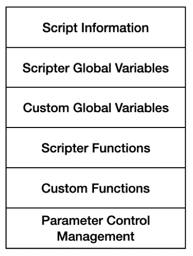
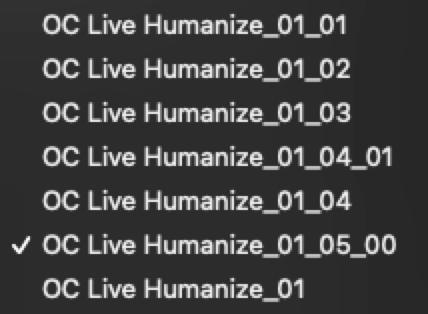

# Scripter’s JavaScript Tutorial

N.B.: This tutorial is the middle section from the book "The Complete Guide to Logic Pro's Scripter." I am posting it here because I am working on an update which replaces this tutorial with a new section on design patterns.

## Introduction

The tutorial covers everything needed to work with JavaScript in Scripter and provides examples within a musical, Scripter, and Logic Pro context wherever possible. The tutorial is divided into the following sections:

*Fundamentals*: This section focuses on the core building blocks of the JavaScript language—statements, syntax, variables, operators—where they are most commonly used in Scripter and includes some basics on organizing code. This is intended for the beginning programmer who has had no exposure to *any* kind of computer code. For experienced programmers, Scripter’s JavaScript syntax is just the same as in any other JavaScript environment, but a review of this section can be helpful because there are a few important differences.

*Advanced*: This brings together everything in Fundamentals by covering objects, branching, functions, and stepping into code quality. It also starts to address working with JavaScript within the context of a track and MIDI events.

*Code Quality:* This section describes ways to write clean, maintainable code. Like any Logic Pro project, Scripter scripts can get complex quickly, and a little consistency and organization will go a long way towards enhancing and debugging scripts. Code style considerations and recommendations are provided: variable naming, how to use spaces, grouping statements, and other options when writing code.

*Bringing It All Together:* This section reviews a fairly complex script in detail, showing all the key points of working with objects, Scripter’s own functionality, and code quality.

The tutorial will not cover everything there is to know about JavaScript, because Scripter is a unique use case which is outside JavaScript’s web-based purposes. Instead, it will cover topics which are typical of working in Scripter. For example, declaring variables with `var`, `let`, and `const` is covered, but the specific differences between `var` and `let` are not because code blocks (`...`) are not covered, so `let` is treated the same as `var` in this book and its examples. `let` is covered to at least expose the reader for when they run into it while searching for answers on the internet.

## JavaScript Fundamentals

### Statements

A statement is an instruction written in JavaScript to tell the computer to do something. Statements are a core building block of JavaScript both in and out of Scripter. Just about anything to be done can be broken down into simple steps and translated into JavaScript statements for execution.

The following example is a valid script containing a single statement which will execute when the *Run Script* button is clicked:

    Trace("Hello, world!");

This tells Scripter’s MIDI Engine to write "Hello, world!" to the Interactive Console:

    ***Creating a new MIDI engine with script***

    Evaluating MIDI-processing script...
    Script evaluated successfully!
    Hello, world
    >

In almost all cases, multiple statements will be needed to do anything of value in Scripter:

    var say_hello = "Hello, world!";
    Trace(say_hello);

In this example, the phrase “`Hello, world!`” is placed in a variable, `say_hello` and then the variable is used to output to the console.

### Syntax

#### Semicolons

MDN: [Grammar and types: Basics](https://developer.mozilla.org/en-US/docs/Web/JavaScript/Guide/Grammar_and_types#basics)

Semicolons separate statements from each other. In the above example, there are two statements, one on each line, each ending with a semicolon. Modern JavaScript and also Scripter, no longer requires semicolons when a line break exists. This example is just as valid as the original:

    var say_hello = "Hello, world!"
    Trace(say_hello)

There are other rules regarding when to use semicolons, which will be addressed in other parts of this tutorial. Whether or not to use semicolons is as much a matter style as anything. Removing the semicolon requirement is a relatively recent change to the language. All of the examples in this book will use the semicolon at the end of statements for clarity and consistency.

#### Comments

MDN: [Grammar and types: Comments](https://developer.mozilla.org/en-US/docs/Web/JavaScript/Guide/Grammar_and_types#comments)

Comments allow for the inclusion of any text within the script without it being processed like code. Typically, these are used to help explain what the code is doing at a particular point and can also prevent execution of code.

Single line comments start with `//` and end with a line break.

    // assign the string to a variable
    var say_hi = "Hello, world!";
    // call Trace using the variable as the argument
    Trace(say_hi);

In the above example, lines 2 and 4 are comments. JavaScript ignores those lines until the line break. Take away the comment tokens at the beginning of the lines and Scripter will throw an error.

##### Multi-line Comments

Multi-line comments are wrapped in `/*` and `*/` and line breaks are ignored.

    /*
    An example showing how to assign and use a variable.
    Scripts are usually way more complex.
    */
    var say_hi = "Hello, world!";
    // Trace(say_hi);

In the above example, lines 1–4 are the multi-line comment and line 6 will not execute.

#### Whitespace

MDN: [Grammar and types: Basics](https://developer.mozilla.org/en-US/docs/Web/JavaScript/Guide/Grammar_and_types#basics)

For the most part, whitespace is ignored in JavaScript except around reserved words. Whitespace can be used to help make code more readable, but there are particular uses which can’t be ignored.

    var say_hi = "Hello, world!";
    varsay_hi = "Hello, world!";
    Trace(say_hi);
    Trace( say_hi );

In the above example:

1.  Line 1 will execute as expected.

2.  Line 2 will throw an error because var is a reserved word in JavaScript. Scripter will think there is already a variable called `varsay_hi` which does not exist.

3.  Lines 3 and 4 are both valid and will execute as expected.

#### Code Blocks

Code can be separated into blocks with line breaks to help make it more readable by grouping similar statements together. Think of code blocks as kind of like a paragraph when reading and writing.

    /*
        An example script to show how everything works
    */

    // declare all the necessary variables
    var user = "Steve";
    var greeting = "Hello, ";

    // combine the variables
    var output = greeting + user;

    // do something with the output
    Trace( output );

In the above example, lines 4, 8, and 11 are blank to make the different steps in the script easier to read. Any computer will simply ignore those empty lines. It’s going to strip all of the comments and empty lines and begin to read the code like this:

    var user="Steve";var greeting="Hello, ";var output=greeting+user;Trace(output);

### Variables

MDN: [Grammar and types: Declarations](https://developer.mozilla.org/en-US/docs/Web/JavaScript/Guide/Grammar_and_types#declarations)

A variable is a kind of named storage for any kind of data.

#### `var` and `let`

MDN:

- [Statements: `var`](https://developer.mozilla.org/en-US/docs/Web/JavaScript/Reference/Statements/var)

- [Statements: `let`](https://developer.mozilla.org/en-US/docs/Web/JavaScript/Reference/Statements/let)

Variables are typically declared with the `var` keyword to make clear something is a new variable.

    var tonic = 60;
    var controlName = "Tonic";

In the above example:

1.  Line 1 shows a variable `tonic` is declared and is assigned with the `=` sign the value of `60`.

2.  Line 2 is very similar: a variable named `controlName` is declared and assigned the value of “`Tonic`”.

Modern JavaScript also uses the `let` keyword, which Scripter supports. The below example has the exact outcome as using `var`.

    let tonic = 60;
    let controlName = "Tonic";

In both cases of `var` and `let`, variables can be assigned new values by leaving off the `var` and `let` keywords:

    var tonic = 60;
    let controlName = "Tonic";
    tonic = 72;
    controlName = "Range";

All of the examples in this book will use `var` to declare variables.

#### `const`

MDN: [Grammar and types: Constants](https://developer.mozilla.org/en-US/docs/Web/JavaScript/Guide/Grammar_and_types#constants)

If there is a value which is read-only (it needs to never change), then the `const` keyword is used, short for “constant”. Constants are typically in all caps to make them easy to identify.

    const MIDDLE_C = 60;

Scripter will throw an error if there is a re-assignment of the variable `middle_c`:

    const MIDDLE_C = 60;
    MIDDLE_C = 0;

    ***Creating a new MIDI engine with script***

    Evaluating MIDI-processing script...
    Script failed to evaluate:
    [JS Exception] TypeError: Attempted to assign to readonly property. line:2
    >

#### Allowed Characters

MDN: [Grammar and types: Variables](https://developer.mozilla.org/en-US/docs/Web/JavaScript/Guide/Grammar_and_types#variables)

Variables have a few rules when naming:

1.  The variable name can only contain letters, numbers, the symbol “$” (dollar sign), and the symbol “`_`” (underscore).

2.  The first character cannot be a number.

3.  Variable names are case sensitive.

The following are examples of valid variable names:

    var activeNotes;
    var beats_per_bar;
    var note1;
    var \$;
    var ActiveNotes; // begins with a capital letter, so it's a new variable.

The following are examples of invalid variable names:

    var 2nd_note;
    var beats-per-bar; // hyphens aren't allowed

#### Reserved Names and Keywords

Both JavaScript and Scripter have reserved words which cannot be reused as variables. The following lists are not exhaustive:

JavaScript: `break`, `case`, `catch`, `class`, `const`, `continue`, `debugger`, `default`, `delete`, `do`, `else`, `export`, `extends`, `finally`, `for`, `function`, `if`, `import`, `in`, `instanceof`, `new`, `return`, `super`, `switch`, `this`, `throw`, `try`, `typeof`, `var`, `void`, `while`, `with`, `yield`

Scripter: `ChannelPressure`, `ControlChange`, `Event`, `GetParameter`, `GetTimingInfo`, `HandleMIDI`, `MIDI`, `NeedsTimingInfo`, `NoteOff`, `NoteOn`, `ParameterChanged`, `PitchBend`, `PluginParameters`, `PolyPressure`, `ProcessMIDI`, `ProgramChange`, `Reset`, `SetParameter`, `TargetEvent`, `TargetEvent`, `Trace`

### Data Types

The concept of data types is critical in any kind of programming. There are many types of data in JavaScript, each with their own particular uses and considerations. JavaScript variables are dynamic, meaning a variable can be assigned any kind of a data type. Some of these have already been seen in the examples, but here we will get into the specifics, especially as it applies to Scripter.

#### Numbers: `Integer` and `Float`

MDN: [Numbers and Dates: Numbers](https://developer.mozilla.org/en-US/docs/Web/JavaScript/Guide/Numbers_and_dates#numbers)

An `Integer` is a number *without* a decimal—a whole number—and a `Float` is a number *with* a decimal. All MIDI-specific values are handled as `Integer` and most Scripter-specific values are handled as `Float`.

    var anInteger = 60; 
    var aFloat = 60.1;

When calculations are made between integers and floats, the result will always be a float.

    var anInteger = 60; 
    var aFloat = 60.1;
    var result = anInteger + aFloat; // 120.1, a float

### String

MDN: [Text Formatting: Strings](https://developer.mozilla.org/en-US/docs/Web/JavaScript/Guide/Text_formatting#strings)

A `String` is a series of characters of any length, including no characters, when wrapped in double or single quotes. In Scripter, strings are primarily used to manage parameter controls and debugging.

    var controlName = "Tonic";
    var emptyString = "";

Strings can be combined with any other data type with the “`+`” operator. When numbers are combined with strings, numbers are automatically converted into strings.

    var string1 = "foo"; // double quotes
    var string2 = 'bar'; // single quotes
    var aNumber = 1;
    var result = string1 + string2 + aNumber; // "foobar1";

Simple formatting for strings is provided with the tab “`\t`” and line break “`\n`” characters:

    var tab = "\tfoo";
    var linebreak = "foo\nbar"; // single quotes
    Trace(tab);
    Trace(linebreak);

    ***Creating a new MIDI engine with script***

    Evaluating MIDI-processing script...
    Script evaluated successfully!
        foo
    foo
    bar
    >

If a back slash `\` is needed in a String, then another back slash is used to “escape” it:

    var second_dom = "V\\V"; // "V\V"

### Boolean

MDN: [Glossary: Boolean](https://developer.mozilla.org/en-US/docs/Glossary/Boolean)

A `Boolean` value is either *true* or *false*. In Scripter, these are used with parameter controls, testing during conditional branching, and is a common property of a track’s state.

    var arpeggiate = true; // arpeggiate the chord
    var arpeggiate = false; // play the chord as notated

### `null` and `undefined`

MDN:

- [Standard Built-in Objects: null](https://developer.mozilla.org/en-US/docs/Web/JavaScript/Reference/Global_Objects/null)

- [Standard Built-in Objects: undefined](https://developer.mozilla.org/en-US/docs/Web/JavaScript/Reference/Global_Objects/undefined)

`Null` and `undefined` are special values. `Null` means that a variable is empty, or that the value is unknown at the time. `Undefined` also means a variable does not have any value, but any variable which is declared *but not assigned a value* is automatically assigned `undefined`.

    var pitch = null; // explicitly assigned null as its value
    var note; // undefined

### Operators and Math

#### Assignment

MDN: [Expressions and Operators: Assignment](https://developer.mozilla.org/en-US/docs/Web/JavaScript/Reference/Operators/Assignment)

The Assignment Operator “`=`” assigns a value to a variable. This has already been shown extensively:

    const CHROMATIC_SCALE = 12;
    var tonic = 60;

#### Addition, Subtraction, Multiplication, Division

MDN:

- [Expressions and Operators: Addition](https://developer.mozilla.org/en-US/docs/Web/JavaScript/Reference/Operators/Addition)

- [Expressions and Operators: Subtraction](https://developer.mozilla.org/en-US/docs/Web/JavaScript/Reference/Operators/Subtraction)

- [Expressions and Operators: Multiplication](https://developer.mozilla.org/en-US/docs/Web/JavaScript/Reference/Operators/Multiplication)

- [Expressions and Operators: Division](https://developer.mozilla.org/en-US/docs/Web/JavaScript/Reference/Operators/Division)

These operators work exactly as expected and will be used extensively in most scripts. Using the variables in the Assignment section:

    const CHROMATIC_SCALE = 12;
    var tonic = 60;
    var addition = tonic + CHROMATIC_SCALE; // 72
    var subtraction = tonic - CHROMATIC_SCALE; // 48
    var multiplication = tonic * CHROMATIC_SCALE; // 720
    var division = tonic / CHROMATIC_SCALE; // 5

#### Remainder (Modulus)

MDN: [Expressions and Operators: Remainder](https://developer.mozilla.org/en-US/docs/Web/JavaScript/Reference/Operators/Remainder)

The remainder (a.k.a. modulus) operator will return the remainder when dividing two numbers which do not divide evenly and return 0 when they do divide evenly. In Scripter, this is critical to doing math with MIDI pitches and knowing which division the playhead is in with `TimingInfo`.

    const CHROMATIC_SCALE = 12;
    var tonic = 61;
    var aFloat = tonic / CHROMATIC_SCALE; // 5.083333333333333
    var remainder = tonic % CHROMATIC_SCALE; // 1
    const MIDDLE_C = 60; // change back to an evenly divisible number
    remainder = MIDDLE_C % CHROMATIC_SCALE; // 0

#### Increment, Decrement, Exponentiation

MDN: [Expressions and Operators: Exponentiation](https://developer.mozilla.org/en-US/docs/Web/JavaScript/Reference/Operators/Exponentiation)

The Increment (++), Decrement (– –), and Exponentiation (\*\*) operators are useful for basic operations without needing a new variable or assignment:

    var pitch = 60;
    pitch = pitch + 1; // 61
    pitch++ // increment to 61 
    pitch-- // decrement to 60
    pitch** // exponent to 3600

#### Combining Strings

MDN: [Expressions and Operators: Addition: String Concatenation](https://developer.mozilla.org/en-US/docs/Web/JavaScript/Reference/Operators/Addition#string_concatenation)

As already seen, a `string` is basically text. In JavaScript, it’s possible to combine strings in much the same way numbers can be added. This is useful in troubleshooting and debugging.

    var text1 = "foo";
    var text2 = "bar";
    var text3 = text1 + text2; // foobar

When combining numbers and strings, numbers are automatically converted into strings:

    var num = 1;
    var str = "bar";
    var text = num + str; // "1bar"

### Comparison Operators

MDN:

- [Operators: Equality](https://developer.mozilla.org/en-US/docs/Web/JavaScript/Reference/Operators/Equality)

- [Operators: Inequality](https://developer.mozilla.org/en-US/docs/Web/JavaScript/Reference/Operators/Inequality)

- [Operators: Greater Than](https://developer.mozilla.org/en-US/docs/Web/JavaScript/Reference/Operators/Greater_than)

- [Operators: Less Than](https://developer.mozilla.org/en-US/docs/Web/JavaScript/Reference/Operators/Less_than)

- [Operators: Greater Than Or Equal](https://developer.mozilla.org/en-US/docs/Web/JavaScript/Reference/Operators/Greater_than_or_equal)

- [Operators: Less Than Or Equal](https://developer.mozilla.org/en-US/docs/Web/JavaScript/Reference/Operators/Less_than_or_equal)

Comparisons are used to test values and determine whether the comparison is true or false. These are primarily needed for branching (`if`) statements.

    == equal to

    60 == 60 // true
    72 == 60 // false

    != not equal

    60 != 60 // false
    72 != 60 // true

    > greater than

    60 > 72 // false
    72 > 60 // true

    < less than

    60 < 72 // true
    72 < 60 // false

    >= greater than or equal to

    72 >= 60 // true
    60 >= 60 // true
    60 >= 72 // false

    <= less than or equal to

    72 <= 60 // false
    60 <= 60 // true
    60 <= 72 // true

### Logical Operators

Logical Operators build upon the above comparison operators by allowing testing of comparisons. In Scripter, these are critical in using `TimingInfo` to determine where the playhead is in regard to bars, beats, and divisions.

#### `&&` logical *and*

MDN: [Operators: Logical AND](https://developer.mozilla.org/en-US/docs/Web/JavaScript/Reference/Operators/Logical_AND)

The `&&` comparison requires *all* comparisons to be true for it to be true. Another way to read the `&&` comparison is that it will find the first *false* result.

    60 == 60 && 72 == 72 // true && true = true
    60 == 60 && 60 == 72 // true && false = false
    60 == 72 && 60 == 60 // false && true = false
    60 == 72 && 60 == 59 // false && false = false

#### `||` logical *or*

MDN: [Operators: Logical OR](https://developer.mozilla.org/en-US/docs/Web/JavaScript/Reference/Operators/Logical_OR)

The `||` (double pipe) comparison will be true when *any* of the comparisons are true. Another way to read the `||` comparison is that it will find the first *true* result and return *true*.

    60 == 60 || 72 == 72 // true || true = true
    60 == 60 || 60 == 72 // true || false = true
    60 == 72 || 60 == 60 // false || true = true
    60 == 72 || 60 == 59 // false || false = false

#### `!` logical *not*

MDN: [Operators: Logical NOT](https://developer.mozilla.org/en-US/docs/Web/JavaScript/Reference/Operators/Logical_NOT)

The `!` comparison tests whether the opposite of something is true. The `!` comparison was already seen with the `!=` not equal comparison.

    60 != 60 // false
    60 != 72 // true
    !true // false
    !false // true

### Type Operators

In Scripter, understanding what kind of event is passed to the `HandleMIDI()` function is critical for most scripts. Understanding the types of data in those events can also be important, especially when just beginning and troubleshooting problems.

#### `instanceof` comparison

MDN: [Operators: instanceof](https://developer.mozilla.org/en-US/docs/Web/JavaScript/Reference/Operators/instanceof)

The `instanceof` comparison returns true if an object is an instance of a particular object type.

    function HandleMIDI(event) {
        if ( event instanceof NoteOn ) {
            Trace("NoteOn");
        }
    }

In the above example:

- Line 1: A MIDI event is passed into the `HandleMIDI()` function.

- Line 2: The `instanceof` comparison is used to determine whether or not the event is `NoteOn`.

- Line 3: If the event is a `NoteOn`, then the script does something with that event. Otherwise, the event is ignored.

#### `typeof` comparison

MDN: [Operators: typeof](https://developer.mozilla.org/en-US/docs/Web/JavaScript/Reference/Operators/typeof)

`typeof` returns true if a variable’s value is a particular data type and uses strings for its returned values.

    var str = "foobar";
    if ( typeof str == "string" ) {
        Trace(str); // "string"
    }
    var num = 60;
    Trace(typeof num); // "number"

In the above example:

- Line 1: A variable is declared and assigned a string value.

- Line 2: The `typeof` comparison is used to determine whether or not the value is of type “`string`”.

- Line 3: If the data type is `string`, then the script does something with that variable.

- Line 5-6: A variable of the `number` data type is created and the `typeof` operator is used to reveal the data type in the console.

### Operator Precedence

MDN: [Operators: Operator Precedence](https://developer.mozilla.org/en-US/docs/Web/JavaScript/Reference/Operators/Operator_Precedence)

When JavaScript executes calculations on statements, it follows an order of precedence similar to PEMDAS (Parentheses, Exponents, Multiplication, Division, Addition, Subtraction). Because there are far more than just those operations, a larger list is defined by the JavaScript language community.

Table  <a href="#Tab:OperatorOrderOfPrecedence" data-reference-type="ref" data-reference="Tab:OperatorOrderOfPrecedence">[Tab:OperatorOrderOfPrecedence]</a> has a complete order of precedence for all operations, including those which are not covered in this book, and PEMDAS operations are highlighted. This level of detail is typically not needed when using Scripter, but is useful to reference in case there is a comparison which is not giving expected results.

### Functions

MDN: [Reference: Functions](https://developer.mozilla.org/en-US/docs/Web/JavaScript/Reference/Functions)

Functions are another core building block of JavaScript (and for most popular programming languages). Essentially, a function is code which is developed to perform a specific task, such as performing a calculation, and that task can be called as needed. Any time a bit of code, be it a line or a block, is repeated, then it should go into a function. The syntax for a function is very simple:

    function name( argument1, argument2 ) {
        // do something
    }

In the above example:

- Line 1: Functions are declared with the `function` statement. The function is given a name, `name` in this example. Following the function name in parentheses, arguments are passed into the function. An argument is data which is passed into the function needed to perform the function’s task. Multiple arguments are separated by commas and functions with no arguments are common.

- Line 2: The code to be executed within the function is opened with a curly brace. Variables passed into, or created in, the function can only be manipulated in the function itself. This is called variable scope. Functions very commonly return values, such as performing a calculation which needs to be done repeatedly.

- Line 3: The function is closed with a curly brace.

A very simple example is adding two numbers together:

    function add( operand1, operand2 ) {
        var result = operand1 + operand2;
        return result;
    }

    var op1 = 2;
    var op2 = 3;
    var sum = add(op1, op2); // sum = 5

In the above example:

- Line 1: A new function is declared, called `add`, which takes two arguments, `operand1` and `operand2`.

- Line 2: The function’s code begins. A new variable `result` is declared and the two arguments are added together.

- Line 3: The sum is returned and the function’s code ends.

- Lines 6–-7: Two values are declared.

- Line 8: A new variable is declared to capture the sum and the function is called. The sum variable stores the returned value of the function.

#### Variable Scope

MDN: [Grammar and Types: Variable Scope](https://developer.mozilla.org/en-US/docs/Web/JavaScript/Guide/Grammar_and_Types#variable_scope)

An important concept to understand about functions is scope. Whenever a variable a declared within a function, then that variable is local to the function. This means the variable cannot be called from outside the function.

    function add( operand1, operand2 ) {
        var sum = operand1 + operand2;
        return sum;
    }
    Trace(operand1);

In the above example, the `Trace()` function tries to use the `operand1` variable, which is declared as one of the function’s arguments. Because the variable is within the function but is called from *outside* the function, Scripter will display the following error in the console:

    [JS Exception] ReferenceError: Can't find variable: operand1 line:5

The variable `operand1` simply does not exist outside of the `add` function. However, variables declared *outside* of the function can be used from *within* the function. The following is a contrived, almost useless example, but the concept will be important to grasp when discussing Scripter’s own variables which can be used from anywhere in a script.

    function add() {
        var result = opr1 + opr2;
        return result;
    }

    var opr1 = 2;
    var opr2 = 3;
    var sum = add(); // sum = 5

In the above example:

- Line 1: The `add` function is declared but without any arguments.

- Line 2: The result is determined by the two variables which are declared on lines 6–-7;

- Line 3: The result is returned.

- Line 8: The `add` function is called *without* any arguments. Note the parentheses are still needed to actually invoke the function.

##### `var` vs `let`

- [Statements: `var`](https://developer.mozilla.org/en-US/docs/Web/JavaScript/Reference/Statements/var)

- [Statements: `let`](https://developer.mozilla.org/en-US/docs/Web/JavaScript/Reference/Statements/let)

In modern JavaScript, variables are typically declared with `let`. Using the previous example, all of the var declarations can be replaced with let and the example would run exactly the same:

    function add() {
        let result = opr1 + opr2;
        return result;
    }

    let opr1 = 2;
    let opr2 = 3;
    let sum = add(); // sum = 5

The reason for `var` vs. `let` in modern JavaScript is because `var` does not have block scope. Variables declared with `var` are not visible outside of functions, but they are visible inside `if-then` blocks, `switch` blocks, etc. Declaring variables with let ensures they are not visible outside of their own scope. However, Scripter’s Javascript ignores this convention of modern JavaScript. Both `var` and `let` create block-scoped variables.

There are a couple more key differences between the two declarations that Scripter *does not* ignore. These are more a matter of style than anything, but they would be considered bad practice in most cases.

A variable declared with `var` can be redeclared multiple times in the same scope.

    var pitch = 60;
    var pitch = 72;
    Trace(pitch); // 72

Scripter has no problem with pitch being re-declared in line 2.

    let pitch = 60;
    let pitch = 72;
    Trace(pitch); // Cannot declare a let variable twice: 'pitch'.

Scripter highlights line 2 as an error and will not run the script.

A variable declared with `var` can be declared before its first use.

    pitch = 60;
    Trace(pitch); // 60
    var pitch;

Scripter has no problem with the variable being declared in line 3.

    pitch = 60;
    Trace(pitch); // Cannot access uninitialized variable. line:1
    let pitch;

Scripter will not run the script with let declaring the variable, but it does not highlight the line as an error; the error will only be revealed during runtime.

Any variable first declared without `var` or `let` is handled as being declared with `var`. Both of these examples work:

    pitch = 60;
    pitch = 72;
    Trace(pitch); // 72

    pitch = 60;
    pitch = 72;
    Trace(pitch); // 72

The variable `pitch` was never explicitly declared with `var` or `let`, but because the variable was successfully assigned a new value the variable is being handled as `var`.

    pitch = 60;
    let pitch = 72;
    Trace(pitch); // Cannot access uninitialized variable. line:1

This example does not work because of the `let` declaration, which cannot be accessed after the variable’s initial use.

#### Scripter’s Callback Functions

Just about every Scripter script will utilize at least one of the following functions, all of which are called by Scripter itself:

- `HandleMIDI()`, called every time there is a MIDI event found in a track at the playhead’s location. The event is passed into the function.

- `ProcessMIDI()`, called upon every new process block. A process block is a predetermined area in the track where the playhead is currently positioned and its length is determined by Logic Pro’s I/O buffer size.

- `ParameterChanged()`, called when the user changes a parameter control in the parameter window. Parameters are maintained in a variable outside of the function.

Many of the examples in this tutorial take place within these functions to help provide context for the example itself.

## JavaScript Advanced

### Arrays

MDN: [Indexed Collections: Array object](https://developer.mozilla.org/en-US/docs/Web/JavaScript/Guide/Indexed_collections#array_object)

Arrays are a data type used to store multiple values within a single variable. An array stores any kind of data in an ordered way like a list, including other arrays, and arrays can also be empty. Arrays are declared with brackets `[...]`. Scripter uses an array to manage parameter controls and arrays are useful for capturing all of the notes in a chord.

#### Create an Array

The most common way to declare an array is assigning the variable with a pair of empty brackets, also known as the *object literal* because the use of array is almost always indicated by brackets. This creates an array that is considered empty, meaning it has no slots in which to save data:

    var scale = [];

Another way to declare an array is assigning the variable with data between the brackets separated with commas:

    var scale = [60, 62, 64, 65, 67, 69, 71];

In the above example, an array is declared with all of the MIDI pitches of the C Major scale starting at Middle C. The same can be done with other data types like strings:

    var scale = ["do", "re", "mi", "fa", "so", "la", "ti"];

The third way to declare an array is to use the `new` keyword. An array is an `Object`, a special data type which has special properties.

    var scale = new Array(7);

In the above example, this declares an array with 7 addresses, but the contents are `undefined`.

As noted before, arrays can store multiple kinds of data in an array.

    var array = ["C", 60];
    Trace(array); // C,60

#### Get Data from an Array

In arrays, each data value is sequentially numbered with an index starting at 0, similar to an address. So, if an array has 7 elements, then the first element is at index 0 and the last element is at index 6. Understanding that the count begins with 0 is important for looping through values.

    var scale = ["do", "re", "mi", "fa", "so", "la", "ti"];
    var d1 = scale[0]; // "do"
    var mi = scale[2]; // "mi"
    var ti = scale[6]; // "ti"
    var d2 = scale[7]; // undefined; out of bounds

In the above example:

- Line 3: The value at index 2 is retrieved, even though a person would normally count that as the 3rd value.

- Line 5: When there is an attempt to retrieve an error out of the bounds of the array, then JavaScript returns `undefined`, a type of “empty” value.

#### Update Data in an Array

Stored values in arrays are counted sequentially starting with 0 and going all the way to *n* − 1 (the number of values as a person would count them minus 1). To update the data already in the array, the index is used within brackets after the array’s name:

    var scale = [60, 62, 64, 65, 67, 69, 71];
    // make the C Major scale Lydian
    scale[3] = 66; // raise the 4th scale degree by a half step
    Trace(scale); // 60,62,64,66,67,69,71

#### Add Data to an Array

Adding data to an array depends on the state of the array. One of the most common methods is to use the `push()` function of an array, which adds a new value to the end of the array.

    var scale = [];
    scale.push(60); // [60]
    scale.push(62); // [60, 62]

In JavaScript, data can be added beyond the bounds of the array and the array will automatically increase in length to accommodate the value.

    var scale = []; // an empty array
    scale[2] = 60; // [,,60] two empty values and then the added value

The `unshift()` function adds a value to the beginning of the array:

    var scale = [69, 71, 72];
    var last = scale.unshift(67); 
    // scale = 67, 69, 71, 72

#### Delete Data from an Array

The `pop()` function returns the last value in the array and returns it.

    var scale = [69, 71, 72];
    var last = scale.pop(); 
    // last = 72
    // scale = [69, 71]

In the above example, the last value in the array was retrieved and then removed from the array.

The `shift()` function removes the first element from the array and returns it.

    var scale = [60, 62, 64];
    var first = scale.shift();
    // first = 60
    // scale = [62, 64]

The `splice()` function removes an element from the array at any location and returns it in an array.

    var array = [60, 62, 64, 65, 67, 69, 71];
    var value = array.splice( 3 , 1 );
    // value = [65] 
    // array = [60, 62, 64, 67, 69, 71]

In the above example, the 4th value in the array is retrieved and then removed from the array.

#### Get Information About an Array

Because arrays are objects, more information can be learned about them than with the previously covered data types (more on objects will come later in this tutorial). Arrays are effectively lists, so the `length` property is used to get how many objects are in the array. What is important to remember is that while array indexes start with 0, the count of values in the array with length will begin with 1 and is counted the way a person would.

    var scale = [69, 71, 72];
    var length = scale.length; // 3

### Objects

MDN: [Working with objects](https://developer.mozilla.org/en-US/docs/Web/JavaScript/Guide/Working_with_Objects)

Objects can store multiple values in a single variable, but are more complex than an array. In addition to using index numbers as addresses, Objects use keys provided as either a String or a Symbol (this tutorial only covers using strings). Each key is associated with a value, which can be any kind of data, including Objects. All of the key-value pairs, also called properties, are handled as an array, separated by commas. Objects are an incredibly powerful tool. Scripter uses objects to handle MIDI Events, `TimingInfo` data, and Parameter Controls.

#### Create an Object

One way to declare an object is assigning the variable with a pair of empty braces `{ }`, otherwise known as an *object literal*. This creates an object that is considered empty, meaning it has no key-value pairs:

    var scale = {};

Another way to declare an object is assigning the variable with data between the braces:

    var scale = {
            "name" : "C Major",
            "pitches" : [60, 62, 64, 65, 67, 69, 71]
        };

In the above example:

- Line 1: The variable is declared with the opening brace.

- Line 2: The first key-value pair is declared. Similar to declaring a variable, a key is created with the string `"name"` and the value for that key is the string `"C Major"`. The key and value are separated with the colon `:`.

- Line 3: The second key-value pair is declared. It is separated from the first pair with a comma, just like in an array.

- Line 4: The closing brace is used with the semicolon to end the statement which declares the variable.

The third way to declare an object is to use the `new` keyword otherwise known as an *object constructor*.

    var scale = new Object();

#### Get data from an object

There are multiple ways to get properties of an object.

    var scale = {
            "name" : "C Major",
            "pitches" : [60, 62, 64, 65, 67, 69, 71]
        };
        
    var name = scale.name;
    var pitches = scale["pitches"];
    var name2 = scale[0];

In the above example:

- Lines 1–4 declare a simple object.

- Line 6 is dot notation, literally the name of the property appended to the object’s name with a dot or period. Dot notation can be used as long as the key follows the rules for variable names.

- Line 7 is the same as an array with square bracket notation. Keys consisting of multiple words in a `string` can be used here.

- Line 8 treats the object just like an array and uses the index for the first key to get the value.

If a key is used which is not actually in the object, then the object will return `undefined`.

#### Update data in an object

To update the data already in the object, the same notation to get data can be used to update. Using the key index number is rare.

    var scale = {
            "name" : "C Major",
            "pitches" : [60, 62, 64, 65, 67, 69, 71]
        };
        
    scale.name = "C Ionian"; // was "C Major"
    scale["pitches"] = []; // replaced the populated array with an empty one
    scale[1] = [0, 2, 4, 5, 7, 9, 11]; // replaced the empty array with a populated one

#### Add data to an object

Data can be added to an object simply by updating the object with a new key.

    scale["sharps"] = [];
    scale.flats = [];

#### Delete data from an object

There are two ways to delete data from an object: delete the data and leave the keyword, or delete both the data and the keyword with the `delete` operator.

    var scale = {
        "name" : "C Major",
        "pitches" : [60, 62, 64, 65, 67, 69, 71]
        };

    scale.name = "";
    delete scale.pitches;

Which results in the following object:

    { 
        "name" : "" 
    }

#### Get information about an object

To check if a property exists in an object, use the `in` operator:

    var hasKey = "name" in scale; // true

To get a list of all keys in an object, there are technically two ways but the most straightforward way for Scripter is to use the `keys()` function for `Object`:

`var keys = Object.keys(scale);`

#### JSON

A very useful technique for debugging is to use JSON (JavaScript Object Notation), which is a text-based format to represent an object’s contents. This is particularly useful for interrogating events passed into the `HandleMIDI()` function:

    function HandleMIDI(event) {
        var json = JSON.stringify(event);
        Trace(json);
    }

In the above example:

- Line 1: An event is passed to the `HandleMIDI()` function, in this example the event will be `NoteOn`.

- Line 2: To get the JSON representation of the object, `JSON.stringify()` is called with the event passed to it. This function returns a string containing the complete JSON.

- Line 3: The string is output to the console, resulting in the following:

<!-- -->

    {"detune":0,"pitch":61,"velocity":100,"status":144,"isRealtime":false,"data1":61,"data3":0,"data2":100,"channel":1,"port":1,"articulationID":0,"beatPos":0}

#### `Trace()` and JSON

MDN: [Global Objects: JSON](https://developer.mozilla.org/en-US/docs/Web/JavaScript/Reference/Global_Objects/JSON)

An important consideration when working with Scripter-sourced objects (as opposed to objects you create yourself) is that `Trace()` will output two different results to the console depending on how the event is used. Both methods are typically needed to get a complete picture of an event. In addition to using JSON as shown previously, there is also using `Trace()` on the event itself:

    function HandleMIDI(event) {
        Trace(event);
    }

...which results in the following output in the console:

    [NoteOn channel:1 pitch:61 [C#3] velocity:100]

The properties shared by the two outputs are `channel`, `pitch`, and `velocity`. When working with a new track, using both the JSON trace and the plain `Trace()` are beneficial to understand just what is happening.

#### MIDI Events are Objects

Working with MIDI Events lies at the core of Scripter and all MIDI Events are handled as Objects. All Events, regardless of type, share the properties and methods listed in Table <a href="#Tab:CommonEventObjectProperties" data-reference-type="ref" data-reference="Tab:CommonEventObjectProperties">[Tab:CommonEventObjectProperties]</a>.

##### Native Scripter Event Objects

In addition to the common Event properties and methods, different types of events have properties which are specific to them as listed in Table <a href="#Tab:NoteOnEventProperties" data-reference-type="ref" data-reference="Tab:NoteOnEventProperties">[Tab:NoteOnEventProperties]</a> for NoteOn, <a href="#Tab:NoteOffEventProperties" data-reference-type="ref" data-reference="Tab:NoteOffEventProperties">[Tab:NoteOffEventProperties]</a> for NoteOff, <a href="#Tab:PolyPressureEventProperties" data-reference-type="ref" data-reference="Tab:PolyPressureEventProperties">[Tab:PolyPressureEventProperties]</a> for PolyPressure, <a href="#Tab:ControlChangeEventProperties" data-reference-type="ref" data-reference="Tab:ControlChangeEventProperties">[Tab:ControlChangeEventProperties]</a> for ControlChange, <a href="#Tab:ProgramChangeEventProperties" data-reference-type="ref" data-reference="Tab:ProgramChangeEventProperties">[Tab:ProgramChangeEventProperties]</a> for ProgramChange, <a href="#Tab:ChannelPressureEventProperties" data-reference-type="ref" data-reference="Tab:ChannelPressureEventProperties">[Tab:ChannelPressureEventProperties]</a> for ChannelPressure (Aftertouch), and <a href="#Tab:TargetEventEventProperties" data-reference-type="ref" data-reference="Tab:TargetEventEventProperties">[Tab:TargetEventEventProperties]</a> for TargetEvent.

`NoteOff` events can be created with their corresponding `NoteOn` events as a convenience:

    var note_off = new NoteOff(note_on);

Doing this duplicates the properties contained in the NoteOn event into the NoteOff event, including the `beatPos` property.

The tutorial scripts say to use the `MIDI.controllerName()` function to get the name of the controller, but that function is undefined at the time of publication.

### Conditional Branching

MDN: [Control Flow and Error Handling: Conditional Statements](https://developer.mozilla.org/en-US/docs/Web/JavaScript/Guide/Control_flow_and_error_handling#conditional_statements)

Events come in a variety of types and just about any manipulation of events will require some kind of decision making about what actions to perform in certain situations. There are 4 types of branching in JavaScript, all applicable to Scripter:

1.  `if` for when a block of code is to be executed when the specified condition is *true*.

2.  `else` for when the specified condition is *false*.

3.  `else if` to specify a new condition when the previous one is *false*.

4.  `switch`, which is a variation on `if...else if`.

Conditional branching is critical to working with events being passed into `HandleMIDI()` and when using `TimingInfo` process blocks to understand which bar and division the playhead is currently in.

#### The `if` statement

MDN: [Control Flow and Error Handling: if...else statement](https://developer.mozilla.org/en-US/docs/Web/JavaScript/Guide/Control_flow_and_error_handling#if...else_statement)

The `if` statement is the simplest of all branching. If a specified condition is *true*, then do something. The `if` statement has a very simple syntax:

    if ( <condition is true> ) {
        <do something>
    }

In the above example:

- Line 1: All `if` statements begin with the reserved word and the condition is contained within parentheses. For the condition to be tested, the comparison, logical, and type operators are used to evaluate whether a condition is *true* or not.

- Line 2: The code to execute is contained within curly braces on lines 1 and 3

A common example is capturing events passed to `HandleMIDI()`:

    function HandleMIDI(event) {
        if (event instanceof NoteOn) {
            Trace(event);
        }
    }

In the above example:

- Line 1: Scripter calls the `HandleMIDI()` function, passing an `event`.

- Line 2: The `if` statement evaluates whether the event is an instance of `NoteOn`.

- Line 3: If the `event` is `NoteOn`, then the `event` is written to the console.

- Line 4: The `if` statement is closed with the curly brace.

This outputs exactly what would be expected with any MIDI data in the track:

    ***Creating a new MIDI engine with script***

    Evaluating MIDI-processing script...
    Script evaluated successfully!
    [NoteOn channel:1 pitch:61 [C#3] velocity:100]
    >

#### The `if...else` statement

MDN: [Control Flow and Error Handling: if...else statement](https://developer.mozilla.org/en-US/docs/Web/JavaScript/Guide/Control_flow_and_error_handling#if...else_statement)

The `if...else` statement accommodates handling code to execute when a condition is *either true or false*. The syntax is very similar:

    if ( <condition is true> ) {
        <do something>
    } else {
        <do something else>
    }

In the above example:

- Lines 1–2: These are exactly the same as the `if` statement.

- Line 3: The first curly brace closes the *true* code block and the *false* code block is opened with the `else` keyword and the curly brace.

- Line 4: The code to be executed when the condition is *false*.

- Line 5: The `false` code block, and the entire `if...else` statement, is closed with the curly brace.

To expand upon the example in `HandleMIDI()`, because there are many types of events:

    function HandleMIDI(event) {
        if (event instanceof NoteOn) {
            Trace("NoteOn");
        } else {
            Trace(event);
        }
    }

In the above example, the following is happening:

- Line 1: Scripter calls the `HandleMIDI()` function, passing an `event`.

- Line 2: The `if` statement evaluates whether the event is an instance of `NoteOn`.

- Line 3: If the event is `NoteOn`, then the event is written to the console.

- Line 4: The `if` statement is closed with the curly brace.

For a simple track with one note, the following is output to the console:

    ***Creating a new MIDI engine with script***

    Evaluating MIDI-processing script...
    Script evaluated successfully!
    NoteOn
    [NoteOff channel:1 pitch:61 [C#3] velocity:64]
    [ControlChange channel:1 number:120 [All Sound Off] value:0]
    >

In the output, note the following:

- Line 5: The `NoteOn` event is captured per the condition event `instanceof NoteOn` and all that is output is the string “`NoteOn`”.

- Lines 6–7: *Neither* event is a `NoteOn`, so the script outputs the events themselves to the console.

#### The `if...else if` Statement

MDN: [Control Flow and Error Handling: if...else statement](https://developer.mozilla.org/en-US/docs/Web/JavaScript/Guide/Control_flow_and_error_handling#if...else_statement)

The `if...else if` statement allows for the testing of multiple conditions. The structure simply expands on the `if` and `if...else` statements:

    if ( <condition 1 is true> ) {
        <do something>
    } else if ( <condition 2 is true> ) {
        <do something else>
    }

This becomes important when trying to capture different kinds of events, a common task in Scripter:

    function HandleMIDI(event) {
        if (event instanceof NoteOn) {
            Trace("NoteOn " + event.pitch);
        } else if (event instanceof NoteOff) {
            Trace("NoteOff " + event.pitch);
        } else {
            Trace(event);
        }
    }

For each event, if it is *either* `NoteOn` *or* `NoteOff`, the pitch is written to the console. Otherwise, with the `else` statement, the event itself is written to the console. So, given a single Middle C note being played in a track, the following is displayed in the console:

    ***Creating a new MIDI engine with script***

    Evaluating MIDI-processing script...
    Script evaluated successfully!
    NoteOn 60
    NoteOff 60
    [ControlChange channel:1 number:120 [All Sound Off] value:0]
    >

##### The Conditional (Ternary) Operator

MDN: [Operators: Conditional Operator](https://developer.mozilla.org/en-US/docs/Web/JavaScript/Reference/Operators/Conditional_Operator)

The Conditional (ternary) operator is a concise version of the `if...then` operator, ideal for small tests which really only need one line of code. The Conditional operator accepts 3 operands, all of which are wrapped in parentheses, “`(...)`”:

    ( <condition> ? <condition is true> : <condition is false> );

1.  A condition to be tested following by a question mark “`?`”.

2.  An expression to be executed when the condition is *true*, followed by a colon “`:`”.

3.  An expression to be executed when the condition is *false*.

<!-- -->

    function testPitchForMiddleC( pitch ) {
        return ( pitch == 60 ? true : false ); 
    }

In the above example, a simple function is declared to test whether a passed integer equals Middle C, MIDI pitch 60. In line 2, the pitch is tested to see if it equals 60, before the question mark. When true, the boolean *true* value is returned, before the colon. When false, *false* is returned.

Using the Conditional operator is really a matter of style and is typically used in short tests which don’t need all of the syntax of a full `if` operator.

#### The `switch` statement

MDN: [Control Flow and Error Handling: switch statement](https://developer.mozilla.org/en-US/docs/Web/JavaScript/Guide/Control_flow_and_error_handling#switch_statement)

The `switch` statement provides the same functionality as the `if...else if...else` statement, but offers a different way to test a particular condition and provides a couple more features to make the script’s logic manageable. The `switch` statement is useful for needing to manage a lot of possibilities for a single condition. The decision to use `switch` or `if` is as much a matter of style as it is need. In Scripter, `switch` is very useful for managing parameter control changes.

Here is the basic syntax:

    switch( <condition> ) {
    case <result 1>:
    // code block
    break;
    case <result 2>:
    // code block
    break;
    default:
    // code block
    }

In the above example:

- Line 1: The condition is wrapped in parenthesis, just like with the `if` statement, and evaluated only once for all of the subsequent cases.

- Line 2: The value of the condition is compared with each case provided.

- Line 3: If there is a match with the first case, then the code for that case is executed.

- Line 4: The `break` keyword causes the `switch` statement to stop evaluating and the script moves on to any code which comes after the entire switch statement.

- Line 5: If the value for the condition does not match the first case, then the `switch` statement moves onto the next case. Otherwise, the code block is executed.

- Line 8: If none of the cases match, then the default code block is executed, if any. Typically, a good idea here is to display a warning to the console if none of the conditions are met.

Cases can also be grouped for common actions by listing cases one right after the other:, shown in lines 5 and 6:

    switch( <condition> ) {
        case <result 1>:
            // code block
            break;
        case <result 2>:
        case <result 3>:
            // code block
        break;
        default:
        // code block
    }

In lines 5 and 6, the same code block is shared between two different values. An example of both the basic structure and the combining of code blocks is shown in the following example, showing which white key is being played regardless of octave (shortened for clarity; a full `switch` statement for all possible MIDI notes would be hundreds of lines long):

    switch (event.pitch) {
        case 48:
        case 60:
        case 72:
            Trace("C");
            break;
        case 50:
        case 63:
        case 74:
            Trace("D");
            break;
        case 52:
        case 65:
        case 76:
            Trace("E");
            break;
        default:
            Trace(event.pitch);
    }

In the above example:

- Line 1: The event’s pitch is evaluated.

- Lines 2–6: If the event’s pitch is 48, 60, or 72, then "C" is output to the console and the switch statement is stopped.

- Lines 7–11, 12–16: The same happens for the notes D and E and their respective pitches.

- Lines 17–18: If the event’s pitch does not meet any of the conditions, then the pitch itself is output to the console.

A very common use of the `switch` statement is to handle changes to controls in the Parameter Window. Parameter controls are stored in the Scripter-sourced array `PluginParameters` and changes are handled in the Scripter-sourced function `ParameterChanged()`.

Please note that this example gets into functions and parameter controls, which are covered in a later section, and while lines 34–-42 contain the `switch` statement, the entire script helps to provide the context for what is being done. Everything else in the example has been covered in the previous sections:

    var PluginParameters = [];
    PluginParameters.push(
        {
            name:"Example Pulldown Menu",
            type:"menu",
            valueStrings:[
                    "Menu Item 1", 
                    "Menu Item 2", 
                    "Menu Item 3"
            ]
        }
    );

    PlugParameters.push(
        {
            name:"Example Checkbox",
            type:"checkbox",
            defaultValue:0
        }
    );

    PluginParameters.push(
        {
            name:"Select Group With",
            type:"menu",
            valueStrings:[
                    "Menu Item 1", 
                    "Menu Item 2"
            ]
        }
    );

    function ParameterChanged(param, value) {
        switch (param) {
            case 0: 
                // this control changed, so do something with the value
                break;
            case 1:
                // this control changed, so do something with the value
            default:
                Trace("Error In ParameterChanged()");
        }
    }

In the above example:

- Line 1: The `PluginParameters` array is declared.

- Lines 2–31: Two parameter controls are pushed to the `PluginParameters` array as objects.

- Line 33: The `ParameterChanged` function is declared with two arguments: the parameter’s index number in the `param` variable and the selected value in the `value` variable.

- Lines 34–41: The `param` variable, which is the parameter control’s array index, is evaluated for the two possible cases. If a value is passed which is not expected according to what is in the `PluginParameters` array, then the error is output to the console.

### Loops

Loops are useful for running the same code repeatedly. The use cases for a loop are almost endless, but they are most often used in Scripter when needing to do something with multiple notes at the same time, like arpeggiating notes in a chord.

#### The `for` Statement

MDN: [Loops and Iteration: for statement](https://developer.mozilla.org/en-US/docs/Web/JavaScript/Guide/Loops_and_iteration#for_statement)

The `for` statement is the most commonly used. It executes a block of code until a condition is false. The for statement has the following syntax:

    for ( <initialize>; <condition>; <increment> ) {
        // code block to do something
    }

In the above example:

- Line 1: The statement is declared with `for` and there are three statements which affect the loop:

  - `Initialize` executes once at the beginning of the loop. This initializes a variable which works within the loop to help manage code execution and is used to test whether the loop’s condition is still *true*.

  - `Condition` is the statement which needs to be *true* for the loop to continue running. Once the condition is *false*, the loop immediately stops and the script moves on to any subsequent code.

  - `Increment` updates the loop’s variable and is executed after the code block within the loop has been executed.

- Line 2: This contains the code (of any length) to be executed within the loop. A `break` statement may also be added to stop the loop early, just like in the `switch` statement.

##### Looping Through Arrays

In the following example, an array is used to store which notes are currently being played in the track. A loop is used to remove notes as `NoteOff` events are captured. Like the larger example from before, this gets into a function—`HandleMIDI()`—to provide context for what is happening within the loop itself and the example is a fairly common task when working in Scripter. The actual loop is in lines 10–16:

    var activeNotes = [];

    function HandleMIDI(event) {

        if ( event instanceof NoteOn ) {
            activeNotes.push(event);
            
        } else if ( event instanceof NoteOff ) {
            var length = activeNotes.length;
            for ( var thisNote = 0; thisNote < length; thisNote++ ) {
                var note = activeNotes[thisNote];
                if ( note.pitch == event.pitch ) {
                    activeNotes.splice( thisNote, 1 );
                    break;
                }
            }
        }
        
        Trace( activeNotes.length );
    }

In the above example:

- Line 1: An array is declared which will store the events. This is created as soon as the "*Run Script*" button is clicked.

- Line 3: Scripter executes the `HandleMIDI()` function whenever a new event is encountered.

- Line 5–17: An `if...else if` statement is used to test what kind of event is being passed into the `HandleMIDI()` function.

- Lines 5-6: If the event is a `NoteOn` event, then add it to the `activeNotes` array.

- Line 8: If the event is a `NoteOff` event, then the following happens:

  - Line 9: The length of the `activeNotes` array is captured in the `length` variable.

  - Line 10: The `for` statement is declared.

    - `var thisNote = 0` declares the loop’s variable. This value will be used as the index to get notes from the `activeNotes` array. Remember that array indexes begin with 0 and increment by 1 until the last item in the array, which has an index of *length - 1*.

    - `thisNote < activeNotes.length` is the condition which is tested. When the index is less than the length of the array, then the code block is executed. When the index equals the length of the array, the loop is immediately stopped and the code block is not executed.

    - `thisNote++` will add 1 to the `thisNote` value after the code block has been executed. Any number can be added to the value for different kinds of increments. For example, to look at every other note in the array, `thisNote += 2` would be used.

- Line 11: The current value of `thisNote` is used as an index in the `activeNotes` array.

- Lines 12–14: The pitch value for `thisNote` is compared to the event. If the patches match, then remove the note from `activeNotes` and stop the loop.

##### Looping through Objects

Looping through the properties of an object is similar to that as with array, except with looping through the keys of the object instead of indexes:

    function HandleMIDI(event) {
        var keys = Object.keys(event);
        var length = keys.length;
        for ( var thisKey = 0; thisKey < length; thisKey++ ) {
            var key = keys[thisKey];
            var value = event[key];
            Trace( key + ":" + value );
        }
    }

In the above example:

- Line 1: Scripter executes the `HandleMIDI()` function whenever a new event is encountered. The event is an `Object` with keys used to get their values.

- Line 2: The `Object.keys()` function is called to get an array of all the object’s keys.

- Line 3: The length of the keys array is captured.

- Line 4: The `for` statement is declared.

  - `var thisKey = 0` declares the loop’s variable. The value will be used as the index to get strings from the `keys` array.

  - `thisKey < length` is the condition to be tested. When the index is less than the length, the code block is executed. When the condition is *false*—`thisKey` equals length—–the loop is immediately stopped.

  - `thisKey++` will add 1 the value of thisKey after the code block has been executed.

### Parameter Controls

All parameters are managed in code, and can be changed at any time, including during play and in reaction to changes another controls.

#### Create Controls

All parameter controls are managed in the global array `PluginParameters`:

    var PluginParameters = [];

This array is a reserved keyword and is case-sensitive. Parameter controls are created as JSON objects and are pushed to the array. The order in which controls are created is the order in which they appear in the Scripter Parameters Window.

    var PluginParameters = [];
    PluginParameters.push({name:"Linear Slider 1", type:"lin", unit:"%", minValue:0, maxValue:100, numberOfSteps:100, defaultValue:50});
    PluginParameters.push({name:"Linear Slider 2", type:"lin", unit:"%", minValue:0, maxValue:100, numberOfSteps:100, defaultValue:50});
    PluginParameters.push({name:"Linear Slider 3", type:"lin", unit:"%", minValue:0, maxValue:100, numberOfSteps:100, defaultValue:50});

The above code appears as the following in the parameters window:

If there are more controls than what will fit in the current window size, then scrolling is enabled. The window can be resized and the UI is responsive, but it can still resort to scrolling whenever there are more controls than window space.

#### Get Values from Controls

To get the value of any control, use the global `GetParameter()` function, which returns the data type appropriate for the kind of control.

    var PluginParameters = [];

    PluginParameters.push({name:"Linear Slider 1", type:"lin", unit:"%", minValue:0, maxValue:100, numberOfSteps:100, defaultValue:50});

    function HandleMIDI(event) {
        var value = GetParameter("Linear Slider 1");
        Trace(value);
    }

    ***Creating a new MIDI engine with script***

    Evaluating MIDI-processing script...
    Script evaluated successfully!
    50
    ...
    >

In the above example, as the track plays and the parameter control changes, then the updated value is returned every time the `HandleMIDI()` or `ProcessMIDI()` functions are called.

`GetParameter()` has to be called from within `HandleMIDI()` or `ProcessMIDI()`, never in the global scope, or Scripter will throw the following error in the console upon clicking the *Run Script* button:

    ***Creating a new MIDI engine with script***

    Evaluating MIDI-processing script..GetParameter() called with an argument: (Linear Slider 1) that does not equal any registered parameter name.
    Script evaluated successfully!
    undefined
    >

#### Update Control Values

To update the value of any control, use the global `SetParameter()` function, which accepts two arguments:

1.  Which parameter to be accessed, which can be done either as the parameter name or the index in the `PluginParameters` array. The parameter name must be exactly the same.

2.  The value to be set for the control, which is always a number.

<!-- -->

    var PluginParameters = [];
    PluginParameters.push({name:"Linear Slider 1", type:"lin", unit:"%", minValue:0, maxValue:100, numberOfSteps:100, defaultValue:50});
    SetParameter("Linear Slider 1", 0);
    SetParameter(0, 0);

In the above example:

- Lines 1–2: A linear slider parameter control is created.

- Line 3: SetParameter is called with the parameter’s name.

- Line 4: SetParameter is called with the parameter’s name.

When `SetParameter()` is called with a name or an index which does not exist in PluginParameters, then the following error is shown:

    SetParameter() called with an argument: (Linear Slider 2) that does not equal any registered parameter name.

`SetParameter()` only works when called from either `HandleMIDI()` or `ProcessMIDI()`, so the track must be playing in order for the callback to make any changes. All changes to parameter controls either by `SetParameter()` or by the user are captured in the `ParameterChanged()` function.

#### Deleting Controls

Since `PluginParameters` is an array, then all `array` functions also apply. While removing the lines of code which create a control can remove the control, the `pop()` and `splice()` functions are used to remove controls in code in reaction to events elsewhere in the script while the track is playing. When a parameter control has been deleted after being created the script, Scripter will display the following message in the console upon the first click of "*Run Script*":

    Number of plugin parameters reduced. Existing automation data may have been deleted.

#### Capturing Parameter Control Updates

The `ParameterChanged()` function is how all parameter control changes are captured in the script, either by the user or in code. The function is optional and is not required for a working script. The function accepts two values:

1.  Which parameter to be accessed as the index in the `PluginParameters` array.

2.  The changed parameter’s value.

In the following example, changes to two controls are captured:

    var PluginParameters = [];

    PluginParameters.push({name:"Linear Slider 1", type:"lin", unit:"%", minValue:0, maxValue:100, numberOfSteps:100, defaultValue:50});
    PluginParameters.push({name:"Linear Slider 2", type:"lin", unit:"%", minValue:0, maxValue:100, numberOfSteps:100, defaultValue:50});
    function HandleMIDI ( event ) {
        
        if ( event instanceof NoteOff ) {
            SetParameter("Linear Slider 1", 50);
            SetParameter("Linear Slider 2", 50);
        }
    }

    function ParameterChanged( param, value ) {
        switch( param ) {
            case 0:
                Trace("Linear Slider 1: " + value );
                break;
            case 1:
                Trace("Linear Slider 2: " + value );
                break;
            default:
                Trace("ERROR: ParameterChanged");
        }
    }

In the above example:

- Lines 1–4: Two linear slider controls are created.

- Lines 7–10: When a `NoteOff` event is encountered by the playhead, the controls are reset to their default values (50).

- Lines 13–24: As the controls are changed by the user or reset in code, the `ParameterChanged()` function is called by Scripter and the value changes are then managed from there (or not).

- Line 13: The two arguments are passed: the parameter control’s `index` in the PluginParameter array and the `value` to which the control was set.

- Lines 14–23: A `switch` statement is used to test which index was passed and the resulting code block is executed.

Note that the `ParameterChanged()` function does not provide the source of the change, either by the user or by any code. All changes are handled the same.

## Code Quality

Good quality code is just as important as a clean project in Logic Pro. Scripts can get complex quickly and code blocks, functions, or even single lines of code can become convoluted and hard to remember their intent over time. The keys to managing that complexity is to be consistent in how the script is written and to clearly document the script’s intent and any changes.

This section serves as a style guide to writing code by moving beyond just the straight functionality provided in this book and providing guidance on how to make any code self-documenting. Some style conventions have already been established in the examples and are documented in the Syntax section below. This section will not get into *all* aspects of good code quality. Whole books have been written on that topic, like the excellent [*Code Complete* by Steve McConnell](https://books.apple.com/us/book/code-complete-second-edition/id850526062), but much of that book goes beyond Scripter’s scope. This section focuses on what is most commonly, and arguably critically, needed for Scripter.

One thing which is important to remember with this guide is that ultimately everyone finds their own style. This section is offered as a collection of suggestions, and while many of them are tried and true, doing what is most comfortable is most important as long as it’s done consistently. Everyone eventually finds nuances which work for them and styles change with practice and experience. But no matter which style is settled upon, consistency is most important over the long term.

### Script Organization

Because scripts need to contain all code in a single file, good high-level organization is key, even for small scripts. Many of the Logic-supplied scripts are organized like this:

A basic script template would then look like this:

    /*
    Name: 
    Author(s): 
    Purpose:
    Information:
    Change History:
        YY_MM_DD_V_##_##_##: Started script
    */

    /*
    SCRIPTER GLOBAL VARIABLES
    */

    var NeedsTimingInfo = true;
    var PluginParameters = [];

    /* 
    CUSTOM GLOBAL VARIABLES 
    */

    /*
    SCRIPTER FUNCTIONS
    */

    function HandleMIDI(event) {
        event.send();
    }

    function ProcessMIDI() {
        var timingInfo = GetTimingInfo();
    }

    function ParameterChanged(param, value) {

    }

    /*
    CUSTOM FUNCTIONS
    */

    /*
    PARAMETER CONTROL MANAGEMENT

    -> Remember to update ParameterChanged()    
    */

Using the above as a template means that no matter how large or small the script ends up being, anyone familiar with the organization know where a particular item is supposed to be, which can be a huge time saver while developing and going back to old scripts. This template will be used as the example in the following sections.

#### DRY: Don’t Repeat Yourself

Wherever possible, try not to duplicate code and variable values. If code is duplicated in multiple places and an error is found in one place, then every other instance of the code or value will need to be reviewed. If code needs to be used in more than one place, then put it in a function. If a value needs to be used in more than one place, then make it a `const` at the top of the script (in the global space).

With both code and values in a single place, then making changes and fixing bugs is faster because it only has to get changed once. By storing values in a variable and reusing the variable, misspellings are less of an issue because when the variable is misspelled it technically doesn’t exist, so Scripter will catch the mistake and throw an error. Scripter has no way of checking for misspellings in strings or whether a typed number is correct or not.

### Comments

Good comments should explain what is being accomplished in the code at a high level. There may be times when a line-by-line explanation is needed, especially if a code block needs to be revisited at some point in the future, but those kinds of comments should be rare. Good variable and function names should be able to fill in those blanks. Comments should require far less maintenance than the code itself. The following are examples of very common types of comments.

#### Summary

A summary comment can contain basic information about the script and can provide helpful context to the script when going back into it after a long time. It’s similar to a `README` file:

    /*
    Name: Live Humanize
    Author(s): Philip Regan
    Purpose: Randomize velocity, beatPos, and detune by Ticks during play
    Information: 
        * Need to increase Tick range to ensure more noticeable changes
    Change History:
        21_10_23_01_00_00: Started script
        21_10_23_01_01_00: Added NoteOn and NoteOff capturing
    */

In the above example, basic but important information is captured in this comment:

- The script’s purpose told in a way of generally how it goes about "humanizing" the music.

- A tweak that needs to be made in the script. This could also be used to record enhancement ideas and bugs to be fixed.

- The script’s change history. Most scripts probably won’t need this section, but when a script grows to any real complexity, this can be useful to know where things left off. As for complex, there are no hard and fast rules, but if there is more than a few controls and/or functions, then recording a basic roadmap of ideas and a change history will likely be helpful.

Summary comments can also be used for at least moderately complex functions:

    /*
    Purpose: Modifies an event's properties based on control settings
    Input: MIDI event
    Output: modified MIDI event
    */
    function humanizeEvent(event) {
        // do something
    }

#### Markers

Comments can be used to mark important sections in a script, as in the example script where there are several comments in capital letters noting which variables and functions belong to Scripter and which are unique to the script. These can be particularly useful in the `ProcessMIDI()` function as that can become long and monolithic quickly even when using functions to organize things.

#### Explanations

Explanations about what a function or code block does are the most common and valuable comments. Like the preamble to this section stated, good explanations should just explain the intent of the code and not be a line-by-line explanation. This keeps the comment low maintenance and all creativity in the code itself. There are times when a line or block of code is both convoluted and critical to a script, so a line-by-line explanation is useful, but that should be rare.

### Variable and Function Names

Variable and functions are one of the single biggest sources of bugs in a script. Good naming of variables and functions will go a long way towards avoiding mistakes later on. Like commenting, variable names should be clear and concise. Good variable names combined with good comments will make code more readable and maintainable. Troubleshooting errors will be made easier by naming things for what they really are.

There are many examples, especially in loops which typically use only a single character for the loop variable, but every piece of data means something to the script and its author. A single character can be fine when the purpose of that character is abundantly clear, like with basic data types— “`s`” for a string, “`i`” or “`n`” for a number. Otherwise, an actual word should be used.

#### Name Variables For What They Are

Every time a variable is declared, that means a piece of data has some kind of important role to play in the script and should be named accordingly. This is particularly true in loops. A common loop style is the following:

    // move each note up one half step
    for (var i = 0; i < array.length; i++) {
        var item = array[i];
        item.pitch += 1;
    }

The comment can become unnecessary with self-documenting code:

    for ( var thisNote = 0 ; thisNotes < notes.length ; thisNote++ ) {
        var note = notes[thisNote];
        note.pitch += HALFSTEP;
    }

In the above example, the following changes were made:

- The loop variable was not clearly the index to the notes array identifying which note was being modified. By changing the loop iterator to specifically naming it a note, the context for its use is very clear.

- By naming the array the plural of what it contains, the array is now clearly holding note events and not just any data.

- Since the code is clearly working on a note, the call to pitch makes more sense.

- A half step is a constant value in music, but a number 1 all alone could be anything, so it is handled as a `const` in code.

A comment may still be needed to explain what’s going on in the loop, especially if it’s a long loop or the code still isn’t immediately obvious. But if the comment were to be deleted for whatever reason (accidents happen!), then some of the context would have been lost in the original example. In the updated example, the code reads more naturally and no one is left having to de-code the code at a later date.

#### Keep Variables Unique

JavaScript’s ability to have a variable contain any kind of data at any point is a double-edged sword. Not having to declare a data type when declaring the variable is a nice convenience, but the purpose of the variable can be made unclear.

    var rootNote = 60;
    for ( var thisNote = 0 ; thisNotes < chord.length ; thisNote++ ) {
        var note = chord[thisNote];
        if ( note.pitch == rootNote ) {
            rootNote = note;
        }
    }

In the above example, the variable `rootNote` is used to store both the target pitch and the note which matches that pitch. However, if the target pitch isn’t found in the chord, then `rootNote` is still 60 and not an actual note object, which the subsequent code may assume to be true. To fix this, use two variables: one for the target pitch and one for the captured note.

    var targetPitch = 60;
    var rootNote;
    for ( var thisNote = 0 ; thisNotes < chord.length ; thisNote++ ) {
        var note = chord[thisNote];
        if ( note.pitch == targetPitch ) {
            rootNote = note;
        }
    }

Then, any code which follows can check to see if `rootNote` actually has a value, as opposed to carrying over 60 which is a value, but is not the correct type:

    if ( rootNote != undefined ) {
        // do something with rootNote
    }

#### Use Global Variables Sparingly

In Scripter, any variable called outside of any function is in the global space, which means it can be called from anywhere else in the script. This can be very convenient, but it also means that how a global variable is being used may not be clear while in the code contained in a function. Obviously, there are variables which need to be global, like the `PluginParameters` array and `NeedsTimingInfo` boolean used by Scripter, and there are aspects to music which are universally true no matter the context, like Middle C. But in order to keep that context of how a variable is being used, it should be managed in the same scope of the code block where it is being used. Global variables help in the following situations:

When data needs to be tracked across instances of the `HandleMIDI()` and `ProcessMIDI()` functions as the playhead moves:

    var NeedsTimingInfo = true;

    var activeNotes = [];
    var lastBlockStart;

    function HandleMIDI( event ) {
        if ( event instanceof NoteOn ) { 
            activeNotes.push( event );
        } else if ( event instanceof NoteOff ) {
            // remove the note from activeNotes
        }
    }

    function ProcessMIDI() {
        var timingInfo = GetTimingInfo();

        if ( timingInfo.playing ) {
            var currBlockStart = Math.floor(timingInfo.blockStartBeat);
            if (  currBlockStart != lastBlockStart \&\& 
            ( currBlockStart <= 1 || currBlockStart \% timingInfo.meterNumerator == 0 ) ) {             
                Trace(lastBlockStart + " - " + currBlockStart)
            }
    }

In the above example, two custom (non-Scripter) variables are tracked: `activeNotes` and `lastBlockStart`. `activeNotes` is used to track what notes are currently playing, so it needs to be tracked across `HandleMIDI()` calls by Scripter. `lastBlockStart` is tracking the last process block start to help calculate when the playhead has entered a new bar. Both of those variables are created outside of those two functions so they can be maintained between calls. All of the other variables needed for these situations are in their respective function’s scope.

When data is about a defining characteristic of music which never changes, like Middle C, or the minimum and maximum values for MIDI, creating global constants is very helpful, especially when creating self-documenting code:

    const MIDDLE_C = 60;
    const MIDI_PITCH_MIN = 0;
    const MIDI_PITCH_MAX = 127;

### Clear Syntax

How a human reads code and how the computer reads it are two very different things. The note array loop example looks a lot like this to the computer:

    var targetPitch=60;var rootNote;for(var thisNote=0;thisNotes<chord.length;thisNote++){var note=chord[thisNote];if(note.pitch==targetPitch){rootNote=note;}}

While the code still works, it is not really readable by anyone other than the computer. While this is an extreme example, it does highlight the importance of writing code in such a way that clearly shows the logic and structure of what is being accomplished and to write for clarity. Fixing a bug in the above example would be unnecessarily challenging.

#### Use White Space

In a lot of code examples found on the Internet, the following format is used for brevity:

    for (var i=0; i<array.length; i++) {
        var item=array[i];
    }

That’s fine for simple, one-off examples. But for times when code is worked on for extended time frames and will likely be updated at some point in the future, the following is more readable:

    for ( var i = 0 ; i < array.length ; i++ ) {
        var item = array[i];
    }

#### Extra Returns and Indents for Code Blocks

The following is syntactically correct but gains nothing:

    var NeedsTimingInfo = true;
    var activeNotes = [];
    var lastBlockStart;
    function HandleMIDI( event ) {
    if ( event instanceof NoteOn ) { 
    activeNotes.push( event );
    } else if ( event instanceof NoteOff ) {
    // remove the note from activeNotes
    }}
    function ProcessMIDI() {
    var timingInfo = GetTimingInfo();
    if ( timingInfo.playing ) {
    var currBlockStart = Math.floor(timingInfo.blockStartBeat);
    if (  currBlockStart != lastBlockStart \&\& 
    ( currBlockStart <= 1 || currBlockStart \% timingInfo.meterNumerator == 0 ) ) {             
    Trace(lastBlockStart + " - " + currBlockStart)
    }}}

What may seem like a benefit in having everything viewable in a single window pane will be much harder to maintain when returned to days or even weeks later.

### Using Functions

#### For Long or Complicated Code

In the following example, the code is very easy to read, but lines 19–20 are challenging to read. Sometimes that’s just the way code works out, and that it’s painful to read compared to the rest of the code is actually a good thing because it means the rest of the code is well-developed.

    var NeedsTimingInfo = true;

    var activeNotes = [];
    var lastBlockStart;

    function HandleMIDI( event ) {
        if ( event instanceof NoteOn ) { 
            activeNotes.push( event );
        } else if ( event instanceof NoteOff ) {
            // remove the note from activeNotes
        }
    }

    function ProcessMIDI() {
        var timingInfo = GetTimingInfo();

        if ( timingInfo.playing ) {
            var currBlockStart = Math.floor(timingInfo.blockStartBeat);
            if (  currBlockStart != lastBlockStart \&\& 
            ( currBlockStart <= 1 || currBlockStart \% timingInfo.meterNumerator == 0 ) ) {             
                Trace(lastBlockStart + " - " + currBlockStart)
            }
    }

For large or complicated test or code blocks, a function can be used to manage readability:

    function ProcessMIDI() {

        // get the current position of the cursor and project play state
        var timingInfo = GetTimingInfo();

        if ( timingInfo.playing ) {
            var currBlockStart = Math.floor( timingInfo.blockStartBeat );
            if (  inNewBar( timingInfo ) ) {            
                Trace( lastBlockStart + " - " + currBlockStart )
            }
    }

    function inNewBar( timingInfo ) {
        if (  currBlockStart != lastBlockStart \&\& 
            ( currBlockStart <= 1 || 
            currBlockStart \% timingInfo.meterNumerator == 0 ) 
        ) {
            return true;
        }
        return false;
    }

The structure of the big Bar test has not changed, and it won’t change unless Apple decides to change the `TimingInfo` object’s structure or how timing information is specified. So, the calculation is put into its own function which makes the actual use of it as simple as a single function call and not multiple comparisons. Any context needed to work on that part of the code is already provided by the name of the function and the fact that `timingInfo` is passed into it.

#### For Out of Scope Code

There are times when code is written as one long monolithic process, or when there are enough conditional and loop statements being indented where understanding what is happening in a particular code block gets hard to keep track of. Oftentimes, this means that the code’s intent, or scope, has gone a step too far from the original intent. In these cases, code blocks which serve a particular purpose should be placed into their own named function to make readability easier. As in the previous `newBar()` function example, the context for that purpose can be provided by the function’s name and the arguments passed into it.

### Versioning

Versioning scripts becomes important once they have a small amount of complexity. Most Logic Pro users likely already back up Logic Pro projects, plugins, samples, and anything else they’ve spent time and/or money on, and scripts should be no different. There are many ways to handle versioning for code and what’s offered here is the most basic to make it as easy as possible for users who don’t code professionally. (Professional coders would use code versioning software like `git` or SVN, but using those go beyond the scope of this book.) There are two simple ways to managing versioning: maintaining a change history, and saving a new file for each change.

#### Change History

There are countless ways a change history can be managed in a script. The framework proposed here comes from work in AppleScript, which are almost invariable single-file scripts like Scripter’s. In the template example is the following in the *Script Information* section:

    Change History:
        21_10_23_01_00_00: Started script
        21_10_23_01_01_00: Added NoteOn and NoteOff capturing

The change history acts like a diary of the script. There are three things being captured in the change history:

1.  The date of the change.

2.  The complexity of the change.

3.  What actually was changed.

The date is in a straightforward `YY_MM_DD` format. Using a date to begin the entry in the change history will make finding back up versions easier when managing scripts with backup software like Time Machine or `git`.

The complexity of the change is captured with version numbers. There are three levels to the version numbers:

- **Major** changes are for significant rewrites of the script: multiple functions are affected, or there is an almost complete rewrite of the script, where the functionality undergoes an obvious change.

- **Minor** changes are generally for bug fixes, or small enhancements; functionality changed in smaller, highly specific scopes.

- **Maintenance** is updating comments, cleaning up syntax, fixing typos.

The exact specific differences between major, minor, and maintenance changes can get blurry, but what’s most important is to record what was changed when.

#### Backups

When combined with a solid change history, backups are easy with backup software. A well-managed change history will have the change dates to very quickly narrow down searches to roll back any changes. At very least, saving new copies of the script when a change is made with the version number in the file name is something which can be done quickly and easily.

### Debugging Errors

Scripter does not offer any debugging tools typically found in other development environments like Xcode or Safari’s Developer Tools. `try...catch` statements can be useful for capturing potential errors in a script and handling them gracefully. At the same time, the `Trace()` function is more useful because it provides insight into most variable’s actual values.

#### The `try...catch` Statement

The intent of `try...catch` is to catch errors in specific tasks before they cause problems. The `try...catch` statement is most effective with one to a few lines of code intended to do one specific thing within a function. This make debugging easy because very specific errors can be written to the console and handled in a way which won’t interfere with the rest of the script. The `try...catch` statement works basically the same as the `if` statement.

    try {
        <code to be attempted>
    } catch ( error ) {
        <code to handle the error>
    }

In the above example:

- Line 1: The `try` keyword opens the try...catch statement.

- Line 2: Code to be attempted is contained within the curly braces. Whenever there is an error in that code, then the script immediately jumps to the `catch` block.

- Line 3: The `catch` block is similar to a function, with an argument passed containing the error. In this example, the argument is named “`error`” but could just as easily be any valid variable name.

- Line 4: Code intended to report and/or handle the error is contained within the curly braces.

### Bringing It All Together: A Script Review

In the section, a script of average complexity is reviewed. The basic script information was provided in one of the previous sections, but here is the full 221-line script:

    /*
    Name: Live Humanize
    Author(s): Philip Regan
    Purpose: Randomize pitch beatPos and velocity during play
    Information:
        X Add negative range to velocity
        X Add min beatPos value negative range?
    Change History:
        21_10_24_01_00_00:  Started script
        21_10_24_01_01_00:  Added beatPos shift
        21_10_24_01_02_00:  Added velocity shift
        21_10_24_01_03_00:  Added negative values to shifts
                            Added probability to beatPos shift 
        21_10_24_01_04_00:  Added probability to velocity
        21_10_24_01_04_01:  Updated variable names to be more consistent
    */

    /*
    SCRIPTER GLOBAL VARIABLES
    */

    var NeedsTimingInfo = true;
    var PluginParameters = [];

    /* 
    CUSTOM GLOBAL VARIABLES 
    */

    const TICKS_IN_BLOCK = 66;
    const TIMING_LENGTH = 0.03289494514465319; // assumes I/O Buffer 1024
    const BEATS_IN_TICK = TIMING_LENGTH / TICKS_IN_BLOCK; // 0.0004984082597674725

    /* Note.beatPos */

    // probability

    const BEATSHIFT_MIN_PROB = 0;
    const BEATSHIFT_MAX_PROB = 100;
    const BEATSHIFT_DEF_PROB = BEATSHIFT_MIN_PROB;
    const BEATSHIFT_PROB_PCNAME = "% Chance beatPos Shift";
    var beatShiftProb = BEATSHIFT_DEF_PROB;

    // shift

    const BEATSHIFT_DEF = 0;
    const BEATSHIFT_STEPS = 8228;

    const BEATSHIFT_MIN = -4224;
    const BEATSHIFT_MIN_DEF = BEATSHIFT_MIN * .05;
    const BEATSHIFT_MIN_PCNAME = "Min beatPos Shift";
    var beatShiftMin = BEATSHIFT_MIN;

    const BEATSHIFT_MAX = 4224;
    const BEATSHIFT_MAX_DEF = BEATSHIFT_MAX * .05;
    const BEATSHIFT_MAX_PCNAME = "Max beatPos Shift";
    var beatShiftMax = BEATSHIFT_MAX;

    /* Note.velocity */

    // probability

    const VELOCITY_PROB_MIN = 0;
    const VELOCITY_PROB_MAX = 100;
    const VELOCITY_PROB_DEF = BEATSHIFT_MIN_PROB;
    const VELOCITY_PROB_PCNAME = "% Chance Velocity Shift";
    var velocityProb = VELOCITY_PROB_DEF;

    // shift

    const VELOCITY_SHIFT_DEF = 0;
    const VELOCITY_SHIFT_STEPS = 254;

    const VELOCITY_SHIFT_MIN = -127;
    const VELOCITY_SHIFT_MIN_PCNAME = "Min Note Velocity Shift";
    var velocityShiftMin = VELOCITY_SHIFT_MIN;

    const VELOCITY_SHIFT_MAX = 127;
    const VELOCITY_SHIFT_MAX_PCNAME = "Max Note Velocity Shift";
    var velocityShiftMax = VELOCITY_SHIFT_MAX;

    /*
    SCRIPTER FUNCTIONS
    */

    function HandleMIDI( event ) {

        if ( event instanceof NoteOn || event instanceof NoteOff ) {
            
            // all probabilities are handled in the functions
            event.velocity = getRandomVelocityShift( event.velocity );
            var beatShift = getRandomBeatShift();
            event.sendAtBeat( event.beatPos + beatShift );
            
        }

        event.send();
    }

    function ProcessMIDI() {
        var timingInfo = GetTimingInfo();
        if ( timingInfo.playing ) {
            // do nothing
        }
    }

    function ParameterChanged( param, value ) {
        switch( param ) {
            case 0:
                beatShiftProb = value;
                break;
            case 1:
                beatShiftMin = value;
                break;
            case 2:
                beatShiftMax = value;
                break;
            case 3:
                velocityProb = value;
                break;
            case 4:
                velocityShiftMin = value;
                break;
            case 5:
                velocityShiftMax = value;
                break;
            default:
                Trace("ERROR: ParameterChanged");
        }
    }

    /*
    CUSTOM FUNCTIONS
    */

    function getRandomBeatShift() {
        var prob = rInt( BEATSHIFT_MIN_PROB, BEATSHIFT_MAX_PROB );
        if ( prob <= beatShiftProb ) {
            var beatPosShift = rInt( beatShiftMin, beatShiftMax );
            return beatPosShift * BEATS_IN_TICK;
        }
        return 0;
    }

    function getRandomVelocityShift( originalVelocity ) {
        var prob = rInt( VELOCITY_PROB_MIN, VELOCITY_PROB_MAX );
        if ( prob <= velocityProb ) {
            var r = rInt( velocityShiftMin, velocityShiftMax );
            return MIDI.normalizeData( originalVelocity + r );
        }
        return originalVelocity;
    }

    function rInt( min, max ) {
    return Math.floor( Math.random() * ( max - min + 1 ) ) + min;
    }

    /*
    PARAMETER CONTROL MANAGEMENT

    -> Remember to update ParameterChanged() 
    */

    PluginParameters.push({
        name: BEATSHIFT_PROB_PCNAME,
        type: "lin",
        minValue: BEATSHIFT_MIN_PROB,
        maxValue: BEATSHIFT_MAX_PROB,
        defaultValue: BEATSHIFT_MIN_PROB,
        numberOfSteps: BEATSHIFT_MAX_PROB,
        unit:"Integer"
    });

    PluginParameters.push({
        name: BEATSHIFT_MIN_PCNAME,
        type: "lin",
        minValue: BEATSHIFT_MIN,
        maxValue: BEATSHIFT_MAX,
        defaultValue: BEATSHIFT_MIN_DEF,
        numberOfSteps: BEATSHIFT_STEPS,
        unit:"Integer"
    });

    PluginParameters.push({
        name: BEATSHIFT_MAX_PCNAME,
        type: "lin",
        minValue: BEATSHIFT_MIN,
        maxValue: BEATSHIFT_MAX,
        defaultValue: BEATSHIFT_MAX_DEF,
        numberOfSteps: BEATSHIFT_STEPS,
        unit:"Integer"
    });

    PluginParameters.push({
        name: VELOCITY_PROB_PCNAME,
        type: "lin",
        minValue: VELOCITY_PROB_MIN,
        maxValue: VELOCITY_PROB_MAX,
        defaultValue: VELOCITY_PROB_MIN,
        numberOfSteps: VELOCITY_PROB_MAX,
        unit:"Integer"
    });

    PluginParameters.push({
        name: VELOCITY_SHIFT_MIN_PCNAME,
        type: "lin",
        minValue: VELOCITY_SHIFT_MIN,
        maxValue: VELOCITY_SHIFT_MAX,
        defaultValue: VELOCITY_SHIFT_DEF,
        numberOfSteps: VELOCITY_SHIFT_STEPS,
        unit:"Integer"
    });

    PluginParameters.push({
        name: VELOCITY_SHIFT_MAX_PCNAME,
        type: "lin",
        minValue: VELOCITY_SHIFT_MIN,
        maxValue: VELOCITY_SHIFT_MAX,
        defaultValue: VELOCITY_SHIFT_DEF,
        numberOfSteps: VELOCITY_SHIFT_STEPS,
        unit:"Integer"
    });

#### Script Overview

Despite its length, the script has a fairly simple workflow. Essentially, once a `NoteOn` or `NoteOff` event is captured, the script will create amounts to shift the `beatPos` and `velocity` for modifying the event.

#### Script Organization

The overall structure of a script as shown in the example template this example:

- Lines 1–16 is the project information.

- Lines 18–23 are the Scripter variables necessary to make the script work: `NeedsTimingInfo` and PluginParameters.

- Lines 25–79 are the custom variables. This section is further divided into three sections, each managing a particular functionality and group of controls:

- Lines 45–56 manages beat position shift settings

- Lines 58–79 manages velocity shifts settings.

- Lines 81–129 are Scripter’s own functions, `HandleMIDI()`, `ProcessMIDI()`, and `ParameterChanged()`.

- Lines 131–155 are the custom functions.

- Lines 157–221 are the parameter controls.

##### DRY: Don’t Repeat Yourself

The "DRY" principle is used in a few places in the script. First, in managing the parameter controls:

    const BEATSHIFT_MIN_PROB = 0;
    const BEATSHIFT_MAX_PROB = 100;
    const BEATSHIFT_DEF_PROB = BEATSHIFT_MIN_PROB;
    const BEATSHIFT_PROB_PCNAME = "\% Chance beatPos Shift";
    var beatShiftProb = BEATSHIFT_DEF_PROB;
    . . . 
    PluginParameters.push({
        name: BEATSHIFT\_PROB\_PCNAME,
        type: "lin",
        minValue: BEATSHIFT\_MIN\_PROB,
        maxValue: BEATSHIFT\_MAX\_PROB,
        defaultValue: BEATSHIFT\_MIN\_PROB,
        numberOfSteps: BEATSHIFT\_MAX\_PROB,
        unit:"Integer"
    });

Lines 1–2 establish a simple probability range. Default values are set to be the minimum for the both the control (line 39) and global value (line 41) so the script doesn’t start off unpredictably. Line 40 establishes the name of the control which is later used on line 164 when the control is created. It can also be used with `GetParameter()`, which accepts a string for the control name. Since the control name is a `const`, that means any further changes to the string are made easier because the change is made in only one place, but then automatically propagated to all its uses in the script. All of the controls are handled in a similar manner.

There is a random number generator which is used in the `getRandomBeatShift()` function (lines 135–142) and `getRandomVelocityShiftI()` function (lines 144–151) :

    function rInt( min, max ) {
        return Math.floor( Math.random() * ( max - min + 1 ) ) + min;
    }

It’s an unusually complex line of code, so by having it in a single function, then any errors are fixed in these lines, and not in every instance where a random number is needed.

#### Comments

All three comment types are in the script.

#### Summary

Lines 1-16 contain the complete summary of the script.

    /*
    Name: Live Humanize
    Author(s): Philip Regan
    Purpose: Randomize pitch beatPos and velocity during play
    Information:
        X Add negative range to velocity
        X Add min beatPos value negative range?
    Change History:
        21_10_24_01_00_00:  Started script
        21_10_24_01_01_00:  Added beatPos shift
        21_10_24_01_02_00:  Added velocity shift
        21_10_24_01_03_00:  Added negative values to shifts
                        Added probability to beatPos shift 
        21_10_24_01_04_00:  Added probability to velocity
        21_10_24_01_04_01:  Updated variable names to be more consistent
    */

With this, anyone new to the script will know its name, how it works, and generally how it was maintained.

##### Markers

There are actually three kinds of markers, similar to the headings in this book:

A top-level section:

    /*
    SCRIPTER GLOBAL VARIABLES
    */

A sub-section:

    /* Note.beatPos */

Other, deeper subsections:

    // probability
    . . . 
    // shift

There is not much to differentiate the last subsections from explanation comments, but they are still helpful all the same.

##### Explanations

There are a few explanation comments in the script. Lines 30–31 have a couple comments which tie into aspects of Logic which are not typically visible in Scripter. These help to provide more context to the calculations in code and can be a useful reference in case anyone want to do something more with them.

    const TIMING_LENGTH = 0.03289494514465319; // assumes I/O Buffer 1024
    const BEATS_IN_TICK = TIMING_LENGTH / TICKS_IN_BLOCK; // 0.0004984082597674725

Line 89 was originally a reminder of where the random number generation happened, because the probability code could easily have been placed in the `ProcessMIDI()` function with only one aspect of a note being modified. However, since there are separate probabilities for each event property, those features are placed in their respective functions. The comment is arguably unnecessary, but since there is a matter of style here, it’s placed as a reminder for a later update.

    // all probabilities are handled in the functions
    event.velocity = getRandomVelocityShift( event.velocity );
    var beatShift = getRandomBeatShift();
    event.sendAtBeat( event.beatPos + beatShift );

Line 102 is also arguably unnecessary. If this script were to be used on a website in a commercial setting, then this entire function would be deleted completely. But in Scripter, there is no cost to having it there, and it provides a useful landmark when scrolling through the code. So, a simple “`do nothing`” is provided to show there is nothing to review. Doing this is largely a matter of style.

    function ProcessMIDI() {
        var timingInfo = GetTimingInfo();
        if ( timingInfo.playing ) {
            // do nothing
        }
    }

Line 160 isn’t so a much an explanation, but rather a reminder that there is another area of code to update when controls are added, changed, or removed.

    /*
    PARAMETER CONTROL MANAGEMENT

    -> Remember to update ParameterChanged() 
    */

#### Variable and Function Names

##### Name Variables For What They Are

In all cases for variables, they are abbreviations of entire words. This balances the number of keystrokes to type the code and at the same time keeps the purpose of the variable clear. There are a couple of styles used for the kinds of variables.

Scripter capitalizes all its own variables and function names:

    var NeedsTimingInfo = true;
    var PluginParameters = [];

    function HandleMIDI( event ) {

Constants are in all caps:

    const TICKS_IN_BLOCK = 66;

All other variables are in “`camelCase`”:

    var beatShift = getRandomBeatShift();

##### Keep Variables Unique

All throughout the script, because variables are named for what they are, keeping their uses unique is easy. Between the function names and the variable names, reading the code’s intent is clear.

One aspect of the code which could be more clear is the `rInt()` function. `rInt()` is supposed to be short for “random integer” but since the function is used so often in the script in lines of code which are already long, the name has been shortened.

##### Use Global Variables Wisely

For a relatively small script, there are a lot of global variables and they are mainly tied to parameter controls. This is a matter of style, but updating the global variables is arguably easier than updating the controls being pushed to the `ParameterControls` array.

#### Clear Syntax

##### Use White Space

White space is used throughout the script in the function calls and `if...then` tests.

    function getRandomVelocityShift( originalVelocity ) {
        var prob = rInt( VELOCITY_PROB_MIN, VELOCITY_PROB_MAX );
        if ( prob <= velocityProb ) {
            var r = rInt( velocityShiftMin, velocityShiftMax );
            return MIDI.normalizeData( originalVelocity + r );
        }
        return originalVelocity;
    }

If the white space were removed, then the above function would look like this:

    function getRandomVelocityShift(originalVelocity) {
        var prob = rInt(VELOCITY_PROB_MIN, VELOCITY_PROB_MAX);
        if (prob<=velocityProb) {
            var r=rInt(velocityShiftMin, velocityShiftMax);
            return MIDI.normalizeData(originalVelocity+r);
        }
        return originalVelocity;
    }

This is purely a matter of style. For certain developers the first example is concise while for other developers, it looks cluttered. In this case, the specific style (almost) doesn’t matter as long as it’s consistent.

##### Extra Returns and Indents for Code Blocks

Extra returns are most apparent in the global variable declarations at the top of the script. For each property being affected, there are blocks to organize probability and ranges.

    /* Note.beatPos */

    // probability

    const BEATSHIFT_MIN_PROB = 0;
    const BEATSHIFT_MAX_PROB = 100;
    const BEATSHIFT_DEF_PROB = BEATSHIFT_MIN_PROB;
    const BEATSHIFT_PROB_PCNAME = "\% Chance beatPos Shift";
    var beatShiftProb = BEATSHIFT_DEF_PROB;

    // shift

    const BEATSHIFT_DEF = 0;
    const BEATSHIFT_STEPS = 8228;

    const BEATSHIFT_MIN = -4224;
    const BEATSHIFT_MIN_DEF = BEATSHIFT_MIN * .05;
    const BEATSHIFT_MIN_PCNAME = "Min beatPos Shift";
    var beatShiftMin = BEATSHIFT_MIN;

    const BEATSHIFT_MAX = 4224;
    const BEATSHIFT_MAX_DEF = BEATSHIFT_MAX * .05;
    const BEATSHIFT_MAX_PCNAME = "Max beatPos Shift";
    var beatShiftMax = BEATSHIFT_MAX;

##### Use Functions For Out of Scope Code

The code within the `getRandomBeatShift()` and `getRandomVelocityShift()` functions could have been included in the `HandleMIDI()` function. But the result would have been this:

    function HandleMIDI( event ) {

        if ( event instanceof NoteOn || event instanceof NoteOff ) {
                    
            var velProbRand = rInt( VELOCITY_PROB_MIN, VELOCITY_PROB_MAX );
            if ( velProbRand <= velocityProb ) {
                var velShift = rInt( velocityShiftMin, velocityShiftMax );
                var velFinal = MIDI.normalizeData( event.velocity + velShift );
                event.velocity = velFinal;
            }
            
            var beatShiftRand = rInt( BEATSHIFT_MIN_PROB, BEATSHIFT_MAX_PROB );
            if ( beatShiftRand <= beatShiftProb ) {
                var beatPosShift = rInt( beatShiftMin, beatShiftMax );
                beatPosShift *= BEATS_IN_TICK;
                event.sendAtBeat( event.beatPos + beatShift );
            }
        }
        
        event.send();
    }

This is a little longer, a little messy, and most of this has nothing to do with actually handling the MIDI event. The code for manipulating or changing the MIDI event should go into their own functions to make everything easier to read and organized.

#### Versioning

##### Change History

What’s important to note in the change history is that it clearly shows the script wasn’t written in a single sitting:

    /*
    Name: Live Humanize
    Author(s): Philip Regan
    Purpose: Randomize pitch beatPos and velocity during play
    Information:
        X Add negative range to velocity
        X Add min beatPos value negative range?
    Change History:
        21_10_24_01_00_00:  Started script
        21_10_24_01_01_00:  Added beatPos shift
        21_10_24_01_02_00:  Added velocity shift
        21_10_24_01_03_00:  Added negative values to shifts
                            Added probability to beatPos shift 
        21_10_24_01_04_00:  Added probability to velocity
        21_10_24_01_04_01:  Updated variable names to be more consistent
    */

For novice developers, what’s important to understand here is that scripts (usually) don’t just spring forth all in one sitting working perfectly the first time the Run Script button is pressed. Like any great piece of music, a good script takes time and multiple changes to make it into something truly useful to a project.

##### Backups

Backups for the script don’t necessarily need to be anything fancy, though is nice to have a backup scheme which requires as little interaction as possible. Every time a change was made, a new file was saved with the version number in the file name:

Cleaning up is done easily enough by going to the folder where all of the scripts are stored and moving them to another location that Logic does not scan on startup. In addition to this, all of the files are backed up using Time Machine.